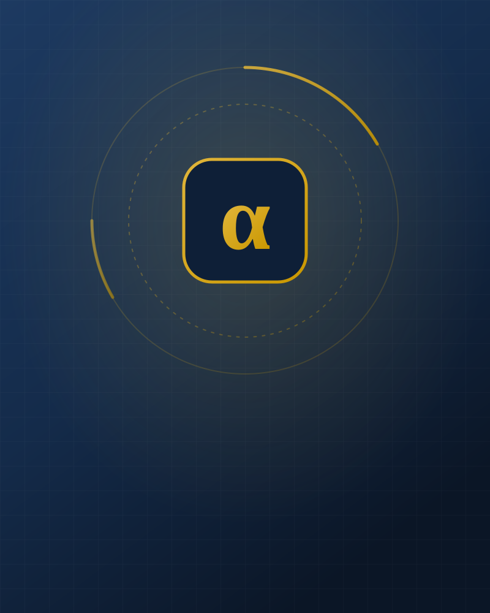

# Photographs and screenshots to supply

Everything below is optional, and the site looks finished without it. Supply originals (JPEG, PNG or HEIC) and they
can be cropped, converted to WebP and stripped of metadata before publishing. **Remove GPS and EXIF data**; most
phones embed location by default.

## 1. Professional portrait (highest value)

| | |
|---|---|
| Appears in | Hero (large, 4:5), About profile card (4:5 desktop, round 96 px on mobile), Speaker profile (round 76 px) |
| Aspect / size | Portrait **4:5**, at least **1200×1500 px**. Head and shoulders, face in the upper 40% of the frame, since the hero terminal overlaps the lower part on desktop. |
| Background | Plain or softly blurred; a dark or neutral tone suits the navy theme. |
| Privacy | No ID badges, lanyards, screens or documents in shot. |

**How to swap it in.** Save it as `assets/images/profile/portrait.webp`. Then, in `index.html`, change each of the
three placeholders (search for `portrait-placeholder.svg`):

```html
<!-- before -->
<figure class="portrait portrait--hero is-placeholder">
  
<!-- after -->
<figure class="portrait portrait--hero">
  
```

Remove `is-placeholder` from all three figures. That makes the portrait visible on mobile in the hero and uses
normal photo cropping. In the hero only, use `alt="Portrait of Ajani Taiwo Micheal"`. In About and Speaking the
name is printed beside the photo, so `alt=""` is correct there and avoids repeating it.

## 2. Project screenshots

16:9, at least **1600×900 px**, captured at 100% zoom. Crop out browser tabs, bookmarks, the OS taskbar and avatar
menus before sending.

| Project card | What to capture | Redaction |
|---|---|---|
| AppSec CI Guardrails | GitHub Actions run #7 summary (all four gates green) and/or run #2 (SAST/SCA failing) | Account menu |
| OSIRIS Intelligence Recon | Terminal running `--list-endpoints` or a `--dry-run` plan against `example.com`; or the HTML report for a lab or test domain | Real targets, IPs, API keys, authorisation IDs |
| AI-Agent AppSec Triage | The generated remediation brief (Markdown preview) once the evaluation is complete | Nothing secret; the planted value is fake, but label it as such |
| CORS & SOP Lab | Attacker page (`localhost:3002`) showing the exfiltrated response next to the fixed version | none (local lab) |
| JWT / Broken Access Control / Cookie labs | Terminal showing a forged-token request returning 403 on the safe server | Use the lab's demo secrets only |
| Dockerised Security Lab | `docker compose ps` output, or the lab landing page | Host names, LAN IPs |
| CyberFloor Cyber Range | Architecture sketch or a virt-manager overview **only when you're ready to publish** | Public IPs, hostnames, WireGuard keys, Cloudflare account details |
| Azure Infrastructure | Portal resource-group view **with the account menu cropped**; the current repo screenshot shows a personal email address | Email, subscription and tenant IDs, public IP |

Store each one in `assets/images/projects/`. Replace the card's
`<div class="project-visual project-visual--plain" …>` with the same `<figure class="project-visual project-visual--shot">`
markup the DevSecOps card uses, and write alt text describing what the screenshot shows.

## 3. Teaching photographs

| | |
|---|---|
| Appears in | Teaching gallery: markup is ready and commented out in `index.html` under "OPTIONAL GALLERY" |
| Aspect / size | **4:3**, at least **1200×900 px**; 3–6 images |
| Content | You presenting, lab set-up, whiteboard or architecture sessions, learners working (backs of heads or screens) |
| Consent | **Written consent from every identifiable learner** (and the college, for SQI premises). Prefer shots where learners can't be identified. Blur names on screens and badges. |

## 4. Speaking and event photographs

Only for events that actually took place; one per event, 4:3. The gallery markup is commented out under
"OPTIONAL EVENT PHOTOS". Check that the organiser permits reuse, and caption each photo with the event name, city
and date.

## 5. Organisation logos (Experience section)

Not added. If you want SQI College of ICT or HackerOne logos, obtain the official files and confirm you're permitted
to use them on a personal site.
